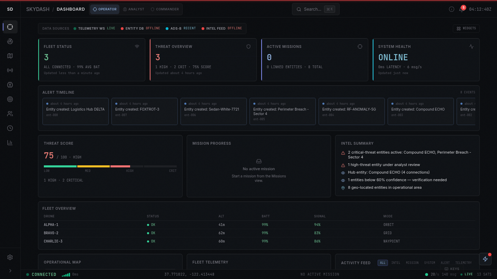
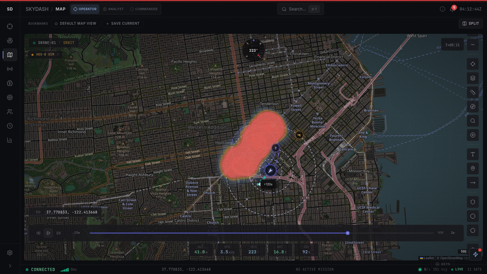
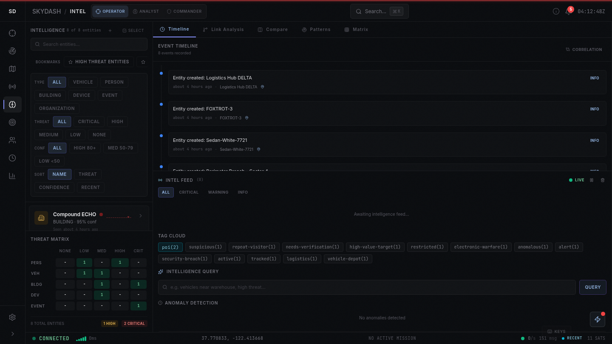

# SkyDash

SkyDash is a web-based common operating picture for unmanned fleets and
geospatial intelligence. It shows a fleet, a map, entities, relationships and
missions on one screen, and can stream positions to TAK clients. It is built to
be inspected: small codebase, documented security model, no required cloud
services.

> **Status: engineering prototype.** All drone telemetry is simulated. SkyDash
> is not accredited or certified for any classification level, is not a real
> ground-control station, and is not a production investigation system. See
> [Limits](#limits).



- Live demo (open, simulated data): https://wonderful-cliff-0325f3800.7.azurestaticapps.net
- API docs: https://skydash-api-38666.azurewebsites.net/docs
- Release status: [docs/current-status.md](docs/current-status.md)

## Features

**Fleet and telemetry**
- Three simulated drones streamed over a WebSocket, with HTTP polling as a
  fallback and a visible degraded-connection banner.
- Command panel (flight mode, altitude, yaw, emergency stop) with a command
  acknowledgement path.
- Scenario Lab: run named scenarios at different speeds and read a scorecard
  (coverage, risk reduced, battery, detections).

**Map**
- Leaflet map with deck.gl overlays: drones, entities, geofences, heatmap,
  measurement and annotation tools, several coordinate formats, saved views.
- Self-hostable basemap tiles. If tiles cannot be loaded the map says
  "BASEMAP OFFLINE" and all overlays keep working.

**Intelligence**
- Entities, relationships and events with provenance, filters, bookmarks,
  link analysis, threat matrix, comparison and timeline views.
- OpenSky (ADS-B) and Shodan connectors with preview and ingest. Shodan returns
  mock data until `SHODAN_API_KEY` is set.

**Missions**
- Mission workspaces with notes, linked entities, briefing and debrief tabs and
  report export.
- Optional RT-DETR frame analysis when the vision dependencies are installed
  (`backend/requirements-vision.txt`).

**Interoperability**
- Cursor-on-Target (CoT) output for every drone and geo-located entity to ATAK,
  WinTAK or a TAK Server input over UDP, TCP or TLS. Outbound only.
- CSV and GeoJSON export for telemetry and entities.

**Operations and security** (all opt-in, see [Configuration](#configuration))
- User accounts with four roles, enforced on the server and reflected in the UI.
- Audit trail with commander-only CSV export, including failed sign-in attempts.
- Session controls: token lifetime, idle timeout, logout that revokes the token,
  WebSocket tickets, password policy, login throttling, optional API rate limit.
- Commander-only account management (change role, disable) and a demo reset.

The interface has three themes (Midnight, Tactical, Arctic) and keyboard
shortcuts for the main views.

| Map | Intel |
| --- | --- |
|  |  |

## Architecture

```text
Browser (React, Vite)  --HTTP/WS-->  FastAPI backend  -->  SQLite
                                         |
                                         +--> CoT stream (UDP/TCP/TLS) to TAK
                                         +--> OpenSky / Shodan (only when called)
```

- **Frontend:** React 18, Vite, Tailwind CSS, Zustand, Leaflet, deck.gl,
  Recharts, Framer Motion, cmdk.
- **Backend:** FastAPI, Uvicorn, Pydantic, SQLite with lightweight migrations.
  Authentication is PBKDF2 password hashing and HS256 JWTs.
- **Containers:** the backend image runs as an unprivileged user; the frontend
  is served by nginx, which also proxies `/api` and `/ws`.
- **Optional:** [skydash_intel_crew](skydash_intel_crew/README.md), a CrewAI
  readiness runner. It is not part of the deployed runtime.

```text
backend/            FastAPI app, stores, routes, auth, RBAC, audit, CoT stream
skydash/frontend/   React application and its tests
e2e/                Playwright specs
docs/               Deployment, security, operations, demo walkthrough
```

## Quick start

Docker (frontend on port 80, API on port 8001):

```bash
cp .env.example .env
docker compose up -d --build
curl http://localhost:8001/health
```

Without Docker:

```bash
# backend
cd backend
pip install -r requirements.txt
python main.py

# frontend, in a second terminal
cd skydash/frontend
npm install
VITE_API_URL=http://localhost:8001 npm run dev
```

Open http://localhost:5173 (dev) or http://localhost (Docker). With no
configuration, authentication is off and there are no roles, which suits a local
demo and nothing else.

## Configuration

Backend variables (set in `.env` or the environment):

| Variable | Purpose |
| --- | --- |
| `SKYDASH_JWT_SECRET` | Turns on authentication, roles and the audit trail. Use a long random value. |
| `SKYDASH_DISABLE_DEMO_USERS` | `1` stops the built-in demo accounts being created. Set it for any real deployment. |
| `SKYDASH_ALLOW_REGISTRATION` | `false` closes public self-registration. |
| `SKYDASH_MIN_PASSWORD_LENGTH` | Minimum length for new passwords (floor 8). |
| `SKYDASH_TOKEN_TTL_MINUTES` | Session lifetime (default 1440). |
| `SKYDASH_RATE_LIMIT_PER_MIN` | Per-client cap on `/api` requests. Off by default. |
| `SKYDASH_TRUST_PROXY` | `1` to use `X-Real-IP` from your reverse proxy for throttling and audit. |
| `SKYDASH_CORS_ORIGINS` | Comma-separated frontend origins. |
| `SKYDASH_API_KEY` | Single shared key, used only when authentication is off. |
| `SKYDASH_MAX_BODY_BYTES` | Request body cap (default 25 MB). |
| `SKYDASH_DB_PATH` | SQLite file location. |
| `SKYDASH_COT_TARGET` | `udp://`, `tcp://` or `tls://` host and port for CoT output. Off when unset. |
| `SKYDASH_COT_INTERVAL` | Seconds between CoT updates (default 5). |
| `SKYDASH_COT_CA`, `SKYDASH_COT_CERT`, `SKYDASH_COT_KEY` | PEM files for `tls://` targets. |
| `SHODAN_API_KEY` | Enables live Shodan queries. |

Frontend build variables:

| Variable | Purpose |
| --- | --- |
| `VITE_API_URL`, `VITE_WS_URL` | Backend HTTP and WebSocket base URLs. |
| `VITE_TILE_URL`, `VITE_TILE_ATTRIBUTION` | Internal tile server for offline or air-gapped use. |
| `VITE_IDLE_TIMEOUT_MINUTES` | Sign out after this many idle minutes when authentication is on. |

Full details, including TLS and air-gapped notes, are in
[docs/deployment.md](docs/deployment.md).

## Security summary

With `SKYDASH_JWT_SECRET` set:

- Roles from lowest to highest: viewer, analyst, operator, commander. Reads need
  a signed-in user, changes need analyst, flight commands need operator, audit
  and account administration need commander.
- Every state-changing request and every sign-in attempt is written to the audit
  trail.
- Signing out revokes the token. Disabling an account ends its sessions,
  including the live data stream.
- Dependencies are audited weekly in CI, which also produces CycloneDX SBOMs.

[docs/security.md](docs/security.md) states exactly what is and is not enforced.
The public demo runs with authentication off.

## Development

```bash
# backend
cd backend && python -m pytest tests

# frontend
cd skydash/frontend
npm run lint
npm test
npm run build
```

CI (`.github/workflows/ci.yml`) runs frontend lint, tests and build with a
bundle-size budget, backend tests with a coverage floor and an API smoke test,
a Playwright smoke suite, and (on `main`) a Docker image build. The `Dependency Audit` workflow runs weekly.

## Documentation

- [Deployment](docs/deployment.md): Docker, production settings, offline use
- [Security](docs/security.md): roles, audit, sessions, proxy and rate limits
- [Demo walkthrough](docs/demo-walkthrough.md): a 10-minute scripted demo
- [Operations runbook](docs/skydash-operations-runbook.md): local, Azure and CI commands
- [Release status](docs/current-status.md): live deployment and open gaps
- [Safety and scope](docs/safety-and-scope.md): misuse boundaries and real-drone limits

## Limits

- Drone telemetry is simulated. No real aircraft are connected.
- The CoT output is a one-way feed, not a full TAK integration.
- Not accredited or certified. Treat it as a prototype for evaluation.
- Storage is a single SQLite file: one backend instance, no clustering.
- The public demo is open and holds no real data.
- CI builds the Docker images but does not run them, so `nginx.conf` is not
  exercised end to end; run `docker compose up` before relying on it.

## License

MIT
